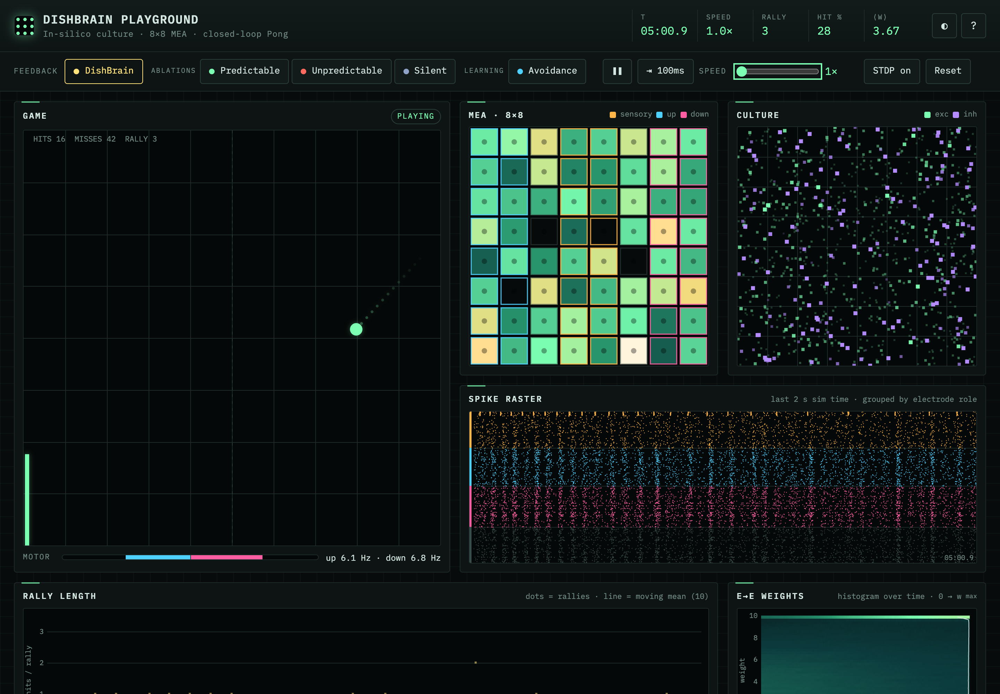

# DishBrain Playground

[](https://github.com/veermshah/dishbrain-playground/actions/workflows/ci.yml)
[](https://github.com/veermshah/dishbrain-playground/actions/workflows/pages.yml)

**Live demo: https://veermickey.com/dishbrain-playground/**

A simulated culture of 1000 spiking neurons sits on a virtual 8×8 electrode array and plays Pong in the
browser. I built it to poke at one question from the DishBrain paper: does the _kind_ of feedback a
network gets after a miss (predictable, unpredictable or none) change how fast it learns?

Short answer, for this model: no. Under the paper's own protocol, plain STDP learns nothing. I then tried
two ways of making it learn. A "learning by stimulation avoidance" loop worked on held-out seeds. Reward-
modulated STDP did not. Details and numbers are below.



## Background

In 2022, Kagan and colleagues at Cortical Labs grew human and mouse cortical neurons on a high-density
multi-electrode array and connected them to a game of Pong [1]. Stimulation on a set of sensory electrodes
told the culture where the ball was (which electrode for the vertical position, pulse rate for distance).
Activity recorded in "motor" regions moved the paddle. The feedback was not a reward signal:

- after a **hit**, the culture got a short **predictable** stimulus (all sensory electrodes, 100 Hz, 100 ms);
- after a **miss**, it got an **unpredictable** stimulus (random sites, 5 Hz, 4 s);
- in the **silent** control, stimulation simply stopped for 4 s after a miss.

Cultures with the full feedback rallied longer in the later part of a 20-minute session than in the first
five minutes, and longer than controls. The authors read this through the free-energy principle [5]: a
self-organising system acts to make its sensory input predictable, so it should drift towards behaviour
that avoids the chaotic noise that follows a miss.

The obvious next question for a modeller is what mechanism could do this. The usual candidate in a
culture is spike-timing-dependent plasticity (STDP) [4]: synapses strengthen when the presynaptic neuron
fires just before the postsynaptic one and weaken in the reverse order. This project tests whether plain
STDP in a generic spiking network is enough.

## What's in the simulation

| Piece    | Model                                                                                                                                                                                                                                                                                                                                                                                                                                                                                                                                                                   |
| -------- | ----------------------------------------------------------------------------------------------------------------------------------------------------------------------------------------------------------------------------------------------------------------------------------------------------------------------------------------------------------------------------------------------------------------------------------------------------------------------------------------------------------------------------------------------------------------------- |
| Neurons  | 1000 Izhikevich neurons [2], 80% regular-spiking excitatory and 20% fast-spiking inhibitory, 1 ms steps                                                                                                                                                                                                                                                                                                                                                                                                                                                                 |
| Wiring   | Fixed out-degree random graph (p = 0.1, 100 synapses per neuron), excitatory delays 1-10 ms, background noise kicks, in the style of [3]                                                                                                                                                                                                                                                                                                                                                                                                                                |
| Learning | Additive trace-based STDP on excitatory-to-excitatory synapses, τ = 20 ms, slightly depression-dominated (A− = 1.2 A+), weights clipped to [0, 10]                                                                                                                                                                                                                                                                                                                                                                                                                      |
| MEA      | Each neuron sits under one of 64 electrodes. Columns 3-4 are sensory, columns 0-1 are the "up" motor region, columns 6-7 are "down", columns 2 and 5 are recording only                                                                                                                                                                                                                                                                                                                                                                                                 |
| Encoding | Place code: the sensory row that gets pulsed is the ball's vertical offset from the paddle, in 8 bins. Rate code: pulse frequency goes from 4 Hz (ball at the far wall) to 40 Hz (ball at the paddle), as in the paper                                                                                                                                                                                                                                                                                                                                                  |
| Decoding | Smoothed population rates of the two motor regions (τ = 100 ms). Paddle velocity is proportional to (down − up)                                                                                                                                                                                                                                                                                                                                                                                                                                                         |
| Feedback | **DishBrain** (default, the paper's protocol): after a hit, all 16 sensory electrodes pulse together at 100 Hz for 100 ms while play continues; after a miss, the game pauses for 4 s while random half-subsets of the sensory electrodes pulse at 5 Hz and 2× amplitude. **Ablations**, which change only what follows a miss and give nothing after a hit: **predictable** (the 100 Hz / 100 ms burst, then a quiet pause), **unpredictable** (the 4 s of random stimulation), **silent** (a quiet 4 s pause, then the game resets, as in the paper's silent control) |

Every condition uses the same 4 s post-miss window, so they differ only in the stimulation they deliver.

The place code is in paddle-relative coordinates. I chose that so a direct sensory-to-motor mapping is
enough to play well: "ball above the paddle" should drive the up region and "ball below" the down region.
That makes the task as easy as I could make it for a learning rule with no memory.

## Running it

Requires Node 22.18 or newer (the scripts use Node's built-in TypeScript support).

```bash
npm install
npm run dev          # open the playground at http://localhost:5173/dishbrain-playground/
npm test             # vitest: neuron determinism, STDP and R-STDP, encoder/decoder, avoidance, physics, stats
npm run build        # type-check and build to dist/
npm run experiment   # headless comparison, writes outputs/experiment.{json,csv} and summary.md
```

`npm run experiment` takes flags: `--seeds 12 --seed-start 1 --minutes 20 --bin 120 --preset dishbrain|highPlasticity|noPlasticity --modes dishbrain,silent --threads 8`.
`--conditions` replaces `--modes` with named conditions of the form `name=mode:presetA+presetB` (see
"Making it learn" for the exact command). Sessions are spread across worker threads; on my machine 48
twenty-minute sessions take about a minute and a half.

### In the browser

- **Feedback** switches live between the DishBrain protocol, the three ablations and the avoidance loop
  (keys `1`-`5`).
- **Pause / step / speed** go from 1× to 100× real time (`Space`, `S`, `+`, `-`).
- **STDP** turns plasticity on and off without restarting (`P`). **Reset** builds a new culture (`R`).
- **Parameters** expose neuron count, connection density, STDP rates and window, noise, pulse amplitude,
  feedback strength and window, motor smoothing and game settings. Presets: _DishBrain-like_, _High
  plasticity_, _Reward-modulated STDP_, _R-STDP with shuffled reward_, _Calibrated motor decode_,
  _Learning rig_ and _No plasticity (control)_.
- **Run experiment** runs N paired seeds per condition in background Web Workers, plots mean learning
  curves with 95% confidence bands, reports Mann-Whitney U tests, and exports CSV or JSON.
- Panels: the game, the 8×8 electrode heatmap (stimulated electrodes are ringed), the spatial layout of
  the culture coloured by recent firing, a 2-second spike raster grouped by electrode role, rally length
  over time coloured by condition, and the E→E weight histogram over time.
- `?` opens an explainer, `T` switches between the dark and light themes. Reduced-motion preferences turn
  off the ball trail and glow.

## Results

Command: `npm run experiment -- --seeds 12 --minutes 20 --bin 120`, so 12 paired seeds per condition and
20 simulated minutes per session (the length of a DishBrain session). Seed _k_ builds the same network and
serves the same first ball in every condition. The metric is hits per rally, averaged within each session
and then across seeds. "Early" and "late" are the first and last thirds of the session. Brackets are 95%
t-intervals across seeds. Raw results are in [`results/`](results/).

**DishBrain-like preset (STDP on)**

| Condition     | Mean rally (all)     | Early third          | Late third           | Late − early          |
| ------------- | -------------------- | -------------------- | -------------------- | --------------------- |
| dishbrain     | 0.306 [0.283, 0.330] | 0.299 [0.249, 0.350] | 0.339 [0.270, 0.408] | 0.040 [−0.062, 0.142] |
| predictable   | 0.301 [0.277, 0.325] | 0.303 [0.249, 0.356] | 0.322 [0.273, 0.372] | 0.020 [−0.045, 0.084] |
| unpredictable | 0.307 [0.282, 0.332] | 0.301 [0.255, 0.346] | 0.354 [0.295, 0.414] | 0.054 [−0.011, 0.118] |
| silent        | 0.309 [0.280, 0.338] | 0.307 [0.251, 0.364] | 0.319 [0.262, 0.375] | 0.012 [−0.051, 0.074] |

Mann-Whitney U, DishBrain protocol against silent: p = 0.30 on late-third rally length and p = 0.38 on
improvement (late − early). Against the predictable and unpredictable ablations, all p > 0.4. Among the
ablations, the lowest p is unpredictable vs silent on late rally, p = 0.24.

**Controls**

| Preset                               | Condition     | Late third           | Late − early           |
| ------------------------------------ | ------------- | -------------------- | ---------------------- |
| No plasticity (STDP off)             | dishbrain     | 0.331 [0.245, 0.417] | 0.047 [−0.031, 0.124]  |
|                                      | predictable   | 0.297 [0.243, 0.351] | −0.010 [−0.082, 0.062] |
|                                      | unpredictable | 0.325 [0.247, 0.402] | 0.032 [−0.040, 0.104]  |
|                                      | silent        | 0.291 [0.239, 0.343] | −0.024 [−0.091, 0.043] |
| High plasticity (2.5× A±, τ = 40 ms) | dishbrain     | 0.350 [0.292, 0.408] | 0.029 [−0.049, 0.107]  |
|                                      | predictable   | 0.334 [0.271, 0.398] | 0.032 [−0.038, 0.102]  |
|                                      | unpredictable | 0.350 [0.290, 0.410] | 0.028 [−0.060, 0.116]  |
|                                      | silent        | 0.309 [0.261, 0.357] | 0.005 [−0.061, 0.071]  |

Across all three presets (36 comparisons), no p-value falls below 0.23.

### What this means

**The DishBrain protocol did not beat silent, and none of the ablations did either.** No condition
learned. Rally length stays around 0.3 hits per rally from start to finish, which is what a paddle drifting
at random gets with this paddle size. The network with plasticity switched off scores the same as the
networks with it on, including under the paper's protocol (0.331 late-third rally length with STDP off,
0.339 with it on), so STDP is not doing anything useful for the task here.

Before settling on the defaults I also tried a small number of variants by hand on 4-6 seeds each:
faster motor decoding (τ = 20 ms), larger STDP steps, a longer STDP window, stronger sensory pulses and
doubled feedback strength. None of them changed the picture, and I did not keep searching for a setting
that "works", because picking whichever configuration happens to clear p < 0.05 would just be p-hacking.

### Why plain STDP can't learn from this feedback

- **Timing.** STDP only pairs spikes about 20 ms apart. The feedback arrives hundreds of milliseconds to
  seconds after the motor activity that decided the hit or miss, so it cannot reach back to the synapses
  that made the move.
- **The feedback isn't contingent on any particular synapse.** The burst and the noise land on the same
  sensory electrodes whatever the network just did. They change whichever synapses happen to be active
  during the feedback, and that set is the same after good moves and bad ones.
- **No reward signal.** STDP has no way to tell a hit from a miss. Its update depends only on spike
  timing, so "predictable" and "unpredictable" are just two stimulation patterns to it, not good and bad
  outcomes.

Bridging that gap needs extra machinery: eligibility traces gated by a neuromodulatory signal
(Izhikevich's dopamine-modulated STDP [6]), or a tight sensorimotor loop in which the network's own action
switches the stimulation off within the STDP window ("learning by stimulation avoidance" [7]). I tried
both; see the next section.

This is also a useful negative result in itself: whatever the cultures in the paper are doing, a generic
STDP network does not reproduce it just by being given the same stimulation protocol.

## Making it learn

To see whether this network can learn at all, I added two mechanisms from the literature that address the
timing problem above, along with a control for each.

**Learning by stimulation avoidance** (`avoidance` mode, after Sinapayen, Masumori and Ikegami [7]).
While the ball approaches and the paddle is out of line, the place-coded sensory electrodes for the ball's
position get 200 Hz Poisson pulses at twice the normal amplitude. A fast motor decode (τ = 5 ms) is checked
every millisecond. As soon as it points the paddle towards the ball, the stimulation stops and any pulse in
flight is cut. Stimulation is capped at 1.5 s per approach, and a miss is followed by a quiet 4 s window.
The contingency now sits inside the STDP window. When "ball above" sensory neurons fire and the up region
answers, the input stops, so those synapses are potentiated without being depressed afterwards. When the
down region answers instead, the input keeps coming, so the pairing is followed by post-before-pre
depression.

**Reward-modulated STDP** (`rstdp` preset, after Izhikevich [6]). The usual STDP updates go into a 1 s
eligibility trace per synapse instead of the weight. A hit delivers +1 and a miss −1, minus the recent
average reward (a reward prediction error over about 20 outcomes). Each synapse then moves by that
reward times its trace. The control, `rstdp-shuffled`, delivers the same rewards at the same moments, but
each one is drawn at random from the session's earlier outcomes, so it carries no information about the
move.

### How I kept this honest

- All tuning used **development seeds 100-111**. The numbers below are from **held-out seeds 1-12**,
  which I ran once, after freezing the configuration.
- On the development seeds, diagnostics showed that the up and down regions have a fixed rate imbalance
  in every condition, silent included. That imbalance pins the paddle to one wall. I added an optional
  slow baseline subtraction to the motor decoder (10 s time constant) to remove it. On the development
  seeds, avoidance also did better with higher plasticity (2.5× STDP steps, 40 ms window). The resulting
  _Learning rig_ preset (calibrated decode plus high plasticity) is the shared base for **every**
  condition below, so they differ only in the mechanism under test.
- Things I tried on development seeds and then fixed: avoidance at 100 Hz and 1× amplitude (too weak),
  then 200 Hz and 2×; R-STDP with reward learning rates of 0.2, 1 and 5, with and without the reward
  baseline. That is the whole search.
- Besides rally length, I report two mechanistic measures:
  - **Steering:** the mean sign of the decoded paddle command relative to the ball while it approaches
    (+1 always towards it, −1 always away), over the last third of the session.
  - **Mapping index:** the mean E→E weight from "ball above" sensory neurons to the up region minus to
    the down region, minus the same difference for "ball below". It is about 0 for random wiring and
    positive when the wiring favours moving towards the ball.

```bash
npm run experiment -- --seeds 12 --seed-start 1 --minutes 20 --bin 120 --out results/learning \
  --conditions dishbrain=dishbrain:learningRig,silent=silent:learningRig,avoidance=avoidance:learningRig,avoidance-no-stdp=avoidance:learningRig+noPlasticity,rstdp=silent:learningRig+rstdp,rstdp-shuffled=silent:learningRig+rstdpShuffled
```

### Results on held-out seeds 1-12

Twenty simulated minutes per session, with the same seeds in every condition. Values are mean [95% CI]
across seeds. The raw data is in [`results/learning/`](results/learning/).

| Condition           | Late-third rally     | Median late rally | Late − early           | Steering (late)         | Mapping index (end)     |
| ------------------- | -------------------- | ----------------- | ---------------------- | ----------------------- | ----------------------- |
| dishbrain           | 0.357 [0.299, 0.415] | 0.34              | 0.033 [−0.065, 0.132]  | −0.066 [−0.153, 0.022]  | −0.036 [−0.153, 0.082]  |
| silent              | 0.364 [0.311, 0.416] | 0.34              | 0.030 [−0.044, 0.105]  | −0.188 [−0.292, −0.084] | −0.082 [−0.257, 0.093]  |
| **avoidance**       | 0.824 [0.218, 1.431] | 0.56              | 0.404 [−0.105, 0.914]  | 0.322 [0.130, 0.515]    | 0.748 [0.522, 0.974]    |
| avoidance, STDP off | 0.356 [0.308, 0.404] | 0.39              | −0.045 [−0.149, 0.058] | 0.049 [−0.044, 0.142]   | 0.012 [−0.009, 0.032]   |
| rstdp               | 0.315 [0.274, 0.356] | 0.33              | −0.010 [−0.080, 0.060] | −0.261 [−0.395, −0.127] | −0.063 [−0.129, 0.003]  |
| rstdp, shuffled     | 0.346 [0.292, 0.400] | 0.31              | −0.009 [−0.097, 0.078] | −0.170 [−0.288, −0.053] | −0.066 [−0.130, −0.003] |

Mann-Whitney U, two-sided:

| Comparison                       | Late rally | Late − early | Steering  | Mapping   |
| -------------------------------- | ---------- | ------------ | --------- | --------- |
| avoidance vs avoidance, STDP off | p = 0.002  | p = 0.008    | p = 0.03  | p < 0.001 |
| avoidance vs silent              | p = 0.009  | p = 0.05     | p < 0.001 | p < 0.001 |
| avoidance vs dishbrain           | p = 0.005  | p = 0.11     | p = 0.001 | p < 0.001 |
| rstdp vs rstdp, shuffled         | p = 0.53   | p = 0.98     | p = 0.24  | p = 0.93  |
| dishbrain vs silent              | p = 0.80   | p = 0.84     | p = 0.09  | p = 0.93  |

### What this means

**Stimulation avoidance learns, and the learning comes from STDP.**

- **Wiring.** The mapping index climbs to 0.75 by the end of the session. With STDP switched off it stays
  at 0.01. So the sensory-to-motor weights really do reorganise towards "ball above → move up" and "ball
  below → move down".
- **Behaviour.** Steering turns positive, and late-session rallies are longer than with the same loop and
  STDP off (p = 0.002). Avoidance beat its STDP-off twin on 10 of the 12 paired seeds.
- **The comparison to trust.** Steering is a little higher with STDP off (0.05) than in silent (−0.19),
  because the stimulation itself nudges the motor regions. That makes "avoidance vs avoidance, STDP off"
  the comparison that isolates learning, rather than "avoidance vs silent".

**The effect is real but modest and uneven.**

- The median late-session rally only goes from about 0.35 to 0.56 hits per rally.
- One seed (seed 7) took off to 3.8 hits per rally, which drags the mean and widens its interval. The
  rank-based tests are not sensitive to it.
- The within-session improvement (late − early) beats the STDP-off twin (p = 0.008). Against silent
  (p = 0.05) and dishbrain (p = 0.11) it is only borderline.

**Reward-modulated STDP did not learn.** It was no different from its shuffled-reward control on any
measure, and its mapping index stayed at zero. My guess is credit-assignment noise. Each reward moves all
64,000 plastic E→E synapses by whatever pairings they collected in the last second, and most of those
pairings come from recurrent activity unrelated to the move. About 230 rewards per 20-minute session is
not enough to average that out. A longer
session, a reward that reaches only the motor regions, or a smaller network might change that. I have not
tested those.

**What it says about DishBrain.** Neither added mechanism is the paper's protocol. Under the paper's
protocol this network still learns nothing, even on the learning rig. What the avoidance result shows is
that STDP can learn this task in closed loop, provided the stimulation the network can avoid ends within
a few milliseconds of the right action. That fits the stimulation-avoidance reading of DishBrain [7]
better than a purely predictability-based one, but it does not show that real cultures learn this way.

## Architecture

```
src/
  core/                framework-free TypeScript, runs in the browser, Web Workers and Node
    rng.ts             seeded mulberry32 PRNG
    network.ts         Izhikevich network in flat typed arrays, CSR synapses, delay ring buffer,
                       STDP and reward-modulated STDP with lazily decayed eligibility traces
    mea.ts             8x8 layout, neuron-to-electrode mapping, place/rate encoder, motor decoder
    pong.ts            game physics
    closedLoop.ts      network <-> MEA <-> game, feedback modes, avoidance loop, rewards, metrics
    experiment.ts      headless sessions, binned learning curves, summaries, CSV
    stats.ts           mean, 95% CI, Mann-Whitney U (exact and normal approximation)
    presets.ts         parameter presets
  sim.worker.ts        live simulation loop, posts ~30 frames/s to the UI
  experiment.worker.ts one headless session per message
  main.ts, ui/         canvas renderers, controls, parameter panel, experiment pool
scripts/
  experiment.ts        Node runner using worker_threads
  screenshot.ts        README screenshots with headless Chrome
tests/                 vitest suites
```

The live view and the experiment runner use exactly the same `ClosedLoop` code, and every run is
deterministic given its seed, so a curve from the browser and the same seed from `npm run experiment`
produce identical numbers. On a laptop the 1000-neuron loop runs at roughly 100× real time on one core.

## Limitations

- **This is a simulation, not neurons.** It has none of the biology that might matter: no glia, no
  short-term plasticity, no neuromodulators, no development, no real electrode physics. A result here says
  something about this model, not about the cultures.
- The network is tiny next to a real culture (1000 neurons against hundreds of thousands) and its
  connectivity is random rather than grown.
- The protocol is simplified: 16 sensory electrodes on an 8×8 grid instead of the paper's layout on a
  high-density array, and stimulation amplitudes are model currents rather than the paper's 75 mV and
  150 mV.
- The paper's separate **no-feedback** condition, where the ball bounces off the back wall and hits and
  misses have no consequence, is not implemented.
- Stimulation is modelled as a current injected into every neuron under an electrode, with no spread to
  neighbours and no stimulation artefact.
- The p-values are uncorrected for multiple comparisons. For the null results that only makes the
  conclusion more conservative. For the avoidance result, the key tests (p = 0.002 on rally length
  against its STDP-off twin, p < 0.001 on the mapping index) would survive a Bonferroni correction over
  the five comparisons in that table.
- The avoidance loop and R-STDP are my additions, not part of the DishBrain protocol. The development
  and held-out seed split guards against overfitting the tuning, but 12 held-out seeds is still a small
  sample.

## References

1. Kagan BJ, Kitchen AC, Tran NT, et al. (2022). In vitro neurons learn and exhibit sentience when embodied
   in a simulated game-world. _Neuron_ 110(23), 3952-3969. https://doi.org/10.1016/j.neuron.2022.09.001
2. Izhikevich EM (2003). Simple model of spiking neurons. _IEEE Transactions on Neural Networks_ 14(6),
   1569-1572.
3. Izhikevich EM (2006). Polychronization: computation with spikes. _Neural Computation_ 18(2), 245-282.
4. Bi G, Poo M (1998). Synaptic modifications in cultured hippocampal neurons: dependence on spike timing,
   synaptic strength, and postsynaptic cell type. _Journal of Neuroscience_ 18(24), 10464-10472.
5. Friston K (2010). The free-energy principle: a unified brain theory? _Nature Reviews Neuroscience_ 11,
   127-138.
6. Izhikevich EM (2007). Solving the distal reward problem through linkage of STDP and dopamine
   signaling. _Cerebral Cortex_ 17(10), 2443-2452.
7. Sinapayen L, Masumori A, Ikegami T (2017). Learning by stimulation avoidance: a principle to control
   spiking neural networks dynamics. _PLoS ONE_ 12(2), e0170388.

## License

MIT, see [LICENSE](LICENSE).
